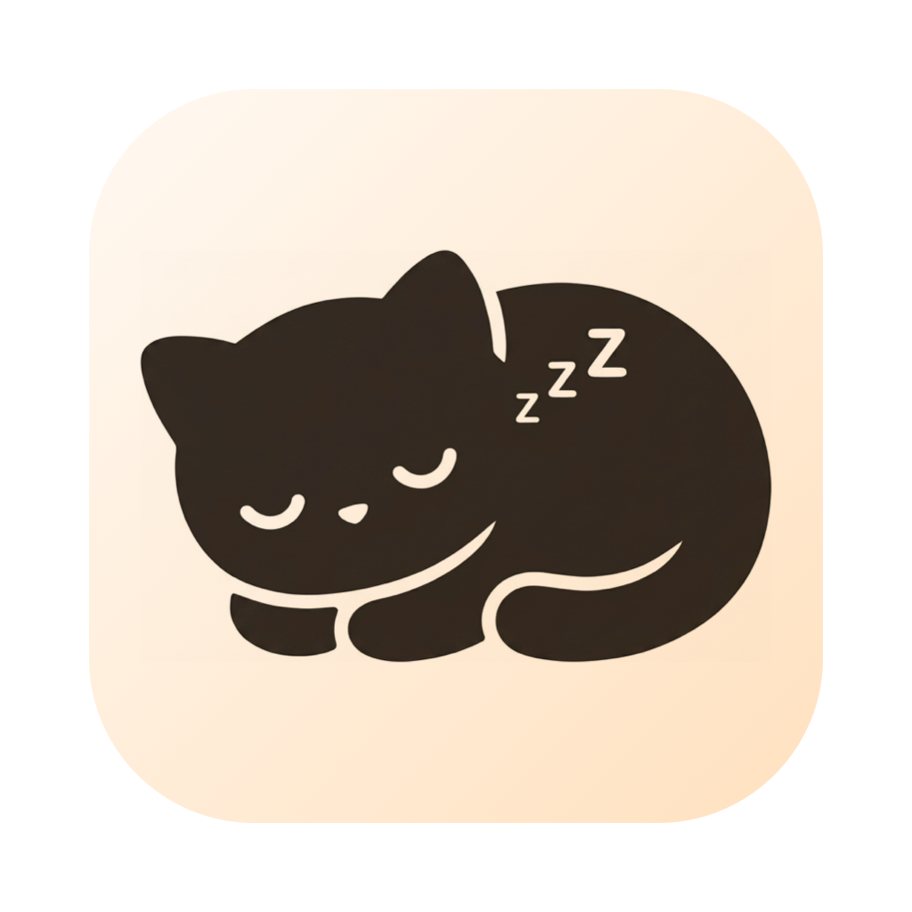
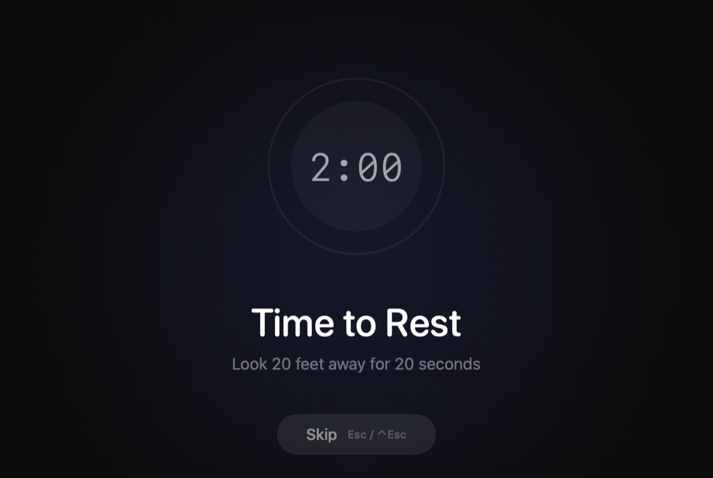
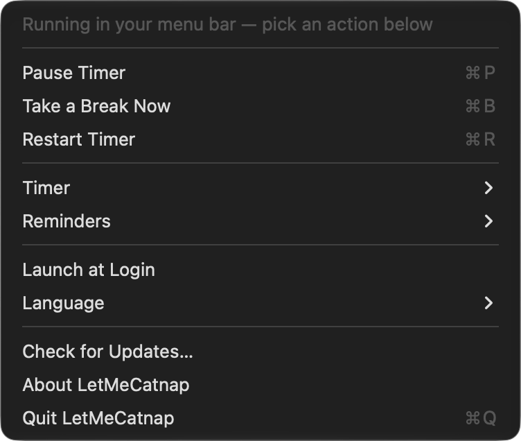

<div align="center">
  
  <h1>iCanHazRepose</h1>
  <p><strong>Take breaks from your screen. Without interrupting your meetings.</strong></p>
  <a href="https://github.com/solitudechn/iCanHazRepose/releases/latest/download/iCHR.dmg">
    
  </a>
  <p><sub>Free and open source. Requires macOS 13+. 简体中文界面。</sub></p>

  [](https://github.com/solitudechn/iCanHazRepose/actions/workflows/ci.yml)
  [](https://github.com/solitudechn/iCanHazRepose/actions/workflows/release.yml)
</div>

<br/>

<div align="center">
  
</div>

<br/>

<div align="center">
  <a href="https://github.com/fikrikarim/repose">originally created by Fikri Karim</a> ·
  <a href="https://github.com/deseven/iCanHazRepose">maintained by deseven</a> ·
  <a href="https://github.com/solitudechn/iCanHazRepose">简体中文 fork</a>
</div>

<br/>

> **This is a fork.** It adds an English / 简体中文 UI on top of
> [deseven/iCanHazRepose](https://github.com/deseven/iCanHazRepose), ships under
> its own bundle identifier (`io.github.solitudechn.icanhazrepose`) and its own
> signed update feed, so it installs next to the original instead of replacing
> it. For anything that is not about the localization, please use the upstream
> repository.

<br/>

iCanHazRepose lives in your menu bar, counts down your work interval, and dims your screen when it's time to rest your eyes. When the break ends, the cycle starts again.

The difference from every other break reminder: **iCanHazRepose detects when you're in a meeting and stays out of your way.** No calendar integration, no app-specific setup. If your camera or mic is active, it knows you're on a call and waits.

The break reminder also respects full screen apps. If you're watching a movie or playing a game a small panel appears in the middle of the screen that doesn't block any input and can be dismissed by pressing Escape.

## How it works

1. Set your work interval (5–90 min) and break duration (20 sec–10 min)
2. A countdown appears in your menu bar
3. When time's up, you will receive a gentle reminder to look away — or choose **Take a Break Now / 立即休息** whenever you need one
4. Optionally take a longer break every N completed work sessions with **Pomodoro Rhythm / 番茄节奏** (manual breaks do not consume a work session)
5. If you're on a call, the break waits until you're done
6. Lock your screen and step away — the timer pauses, and unlocks into a fresh cycle
   (reminders → pause when: lock screen, idle, either, or never)
7. One minute before a break the menu bar icon turns into an hourglass and chimes softly, so the overlay is never a surprise
8. During the break you get a short tip ("look 20 feet away", "roll your shoulders") instead of a ticking clock — the countdown fades out after three seconds, tap the ring if you want it back

<div align="center">
  
</div>

Everything is in the menu — pause, resume, restart, all settings. No separate preferences window.

## Why the meeting detection actually works

Most break apps check your calendar or look for specific apps running. Both break easily — your calendar doesn't know about the impromptu call your manager just started, and "Zoom is open" doesn't mean you're in a meeting.

iCanHazRepose checks the hardware directly. It uses CoreMediaIO to detect active cameras and CoreAudio for microphones. If something is using your camera or mic right now, you're probably in a call, so it backs off.

This means it works with Zoom, Meet, FaceTime, Teams, Slack huddles, and whatever you end up using next year. Zero configuration.

## When the timer pauses

Most break apps pause on keyboard inactivity — but "no keyboard for two minutes" also describes reading a document, which is exactly when you need the reminder. By default iCanHazRepose waits for the signal that actually means you left: the screen locking, or the display going to sleep. Unlock and you get a fresh work cycle, because a locked screen is a real break.

If you never lock your screen, **Reminders → Pause When** offers the idle-based behaviour instead: pause only (`Idle for 5 Minutes`), both signals (`Screen Locks or Idle`), or never pause automatically. Idle is opt-in because it is the noisy one — five minutes without input is the threshold, so reading a document is no longer mistaken for leaving.

The break screen hides its countdown after three seconds and puts the guidance front and centre — staring at a ticking number is the opposite of resting your eyes. Tap the ring to see the time left. Escape closes a break too, unless you turned off **Reminders → Allow Skip Break**.

## Install

### Download

**Stable** release — download from the [Releases](https://github.com/solitudechn/iCanHazRepose/releases) page.

The download is not notarized, so the first launch may be blocked by Gatekeeper
("damaged" / "cannot be verified"). Clear the quarantine flag once:

```sh
xattr -dr com.apple.quarantine /Applications/iCanHazRepose.app
```

**Dev** build — every push to `main` is compiled by CI; grab the artifact from the
[latest CI run](https://github.com/solitudechn/iCanHazRepose/actions/workflows/ci.yml).
*(only use this if you need unreleased functionality or want to help with testing)*

### Build from source

```
git clone https://github.com/solitudechn/iCanHazRepose.git
cd iCanHazRepose
./build.sh
```

Requires macOS 13+ and a full **Xcode** (Command Line Tools alone cannot expand
the SwiftUI macros). If `xcode-select` still points at CLT after installing
Xcode, `build.sh` picks the newest `/Applications/Xcode*.app` by itself.

`./build.sh` builds a debug binary and launches it; `./build.sh ci` produces the
same artifacts as a release (universal binary, `iCHR.zip`, `iCHR.dmg`) without
uploading or launching anything.

## Updates

Updates are handled by [Sparkle 2](https://sparkle-project.org), not by
hand-rolled code:

- the feed is `https://github.com/solitudechn/iCanHazRepose/releases/latest/download/appcast.xml`,
  so publishing a release is the only step needed to ship an update;
- every release archive is signed with an Ed25519 key; the public half lives in
  `Info.plist` as `SUPublicEDKey`, and Sparkle refuses anything that does not
  match;
- Sparkle asks for an administrator password when `/Applications` is not
  writable, instead of failing after the app has already quit.

Checks run once a day in the background and on demand from **Check for
Updates…** in the menu. Skip a version and Sparkle stops offering it.

## Tests and checks

Timing rules, settings and the string table live in the `ICHRCore` module so they
can be tested without AppKit:

```
./scripts/verify.sh                 # format lint + copy check + unit tests
```

Individually:

```
swift test --filter ICHRCoreTests   # needs a full Xcode (XCTest)
python3 scripts/check-l10n.py       # every key translated, no stray literals
swift format lint -r src core Tests # style, config in .swift-format
```

All of them run in CI on every push.

## Localization / 界面语言

The UI ships with **English** and **简体中文** and follows your system language by default. Override it any time from the menu bar: **Language / 语言 → 跟随系统 / English / 简体中文**. The change applies immediately — no restart needed.

界面默认跟随系统语言（英文 / 简体中文），也可随时在菜单栏 **语言** 里手动切换，无需重启应用。

Every user-visible string is a case of `LocKey` in
[`core/L10n.swift`](core/L10n.swift), with both translations in
[`core/StringTable.swift`](core/StringTable.swift). A missing key is a compile
error, and `StringTableTests` fails if a translation is empty, lost its `%@`/`%ld`
placeholder, or kept the English side untranslated.

简体中文界面由 [solitudechn](https://github.com/solitudechn) 汉化并维护。

One exception: Sparkle's own update dialogs follow the *system* language rather
than the in-app **Language** switch — they come from inside the framework, not
from `StringTable`.
